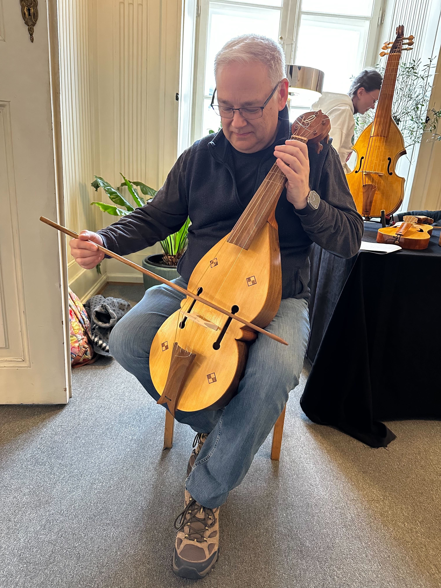

Thanks to suggestion from a friend, I was able to try out a few old-style stringed instruments at String Days in Krakow, PL. This is my first time with a bowed instrument since my college days. 

I played violin from grade school through my first year of university. Some of my best experiences and memories are the result of playing violin. In a private session my university professor said "Michael you are the best site reader I've worked with - but your 100th playing isn't much better than your first." A hard life lesson that I am still mildy obsessed with. I've been fortunate to get away with a lot of laziness in many aspects of life, a gift I have ever since been working to overcome.   

Special thanks to Matthew Farley at [Early Music Instruments](https://www.earlymusicinstruments.com) for the use of this "fiddle".

And btw, I know it looks like I am holding the bow wrong, but apparently this was the proper grip back in the day.

